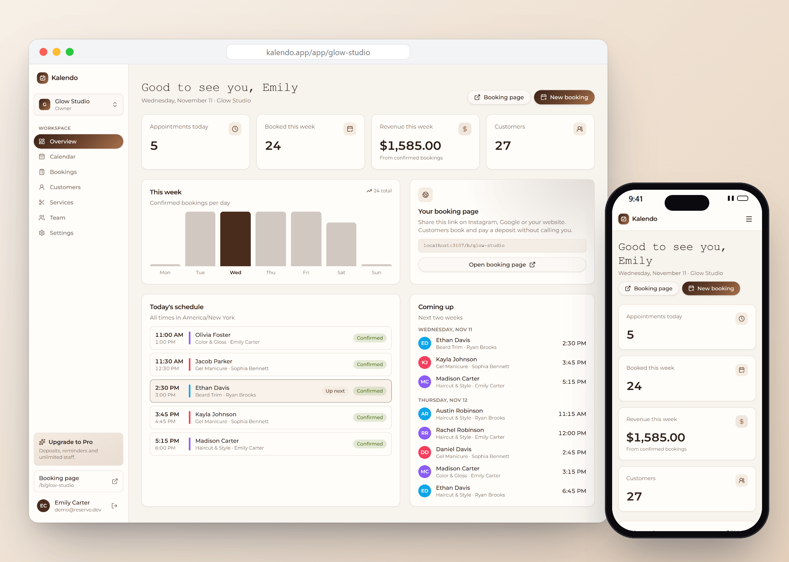
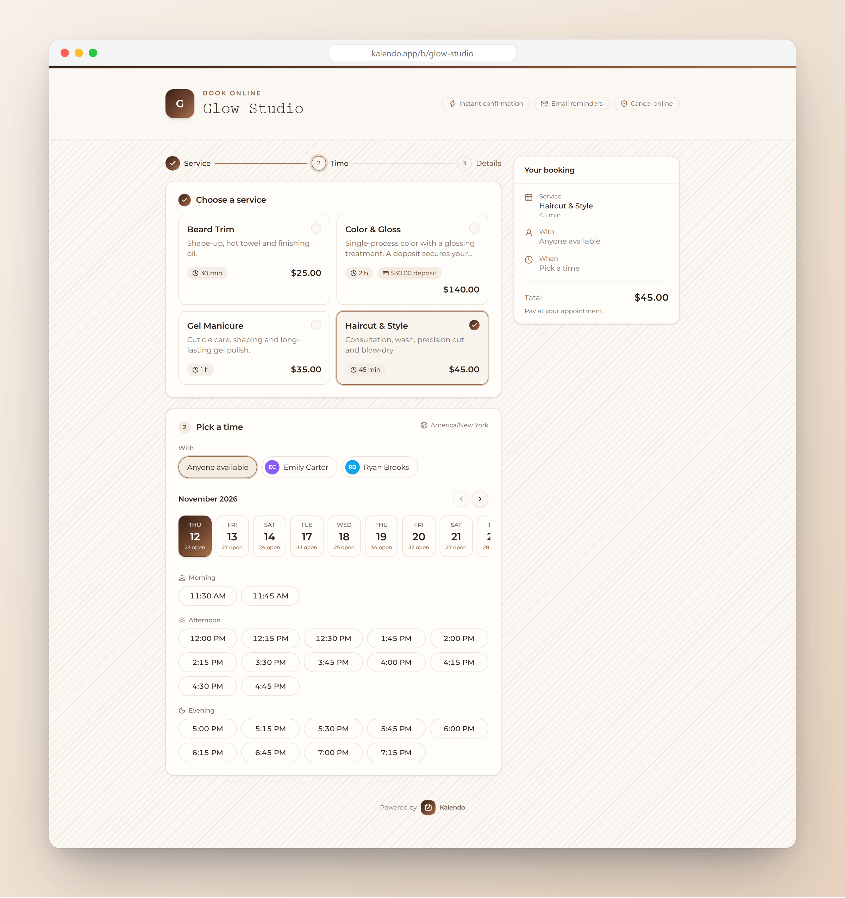
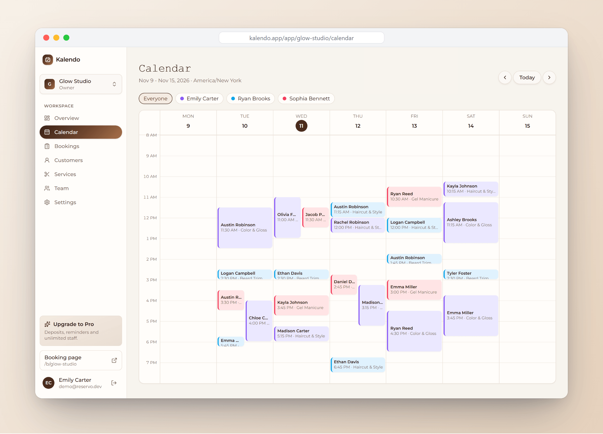
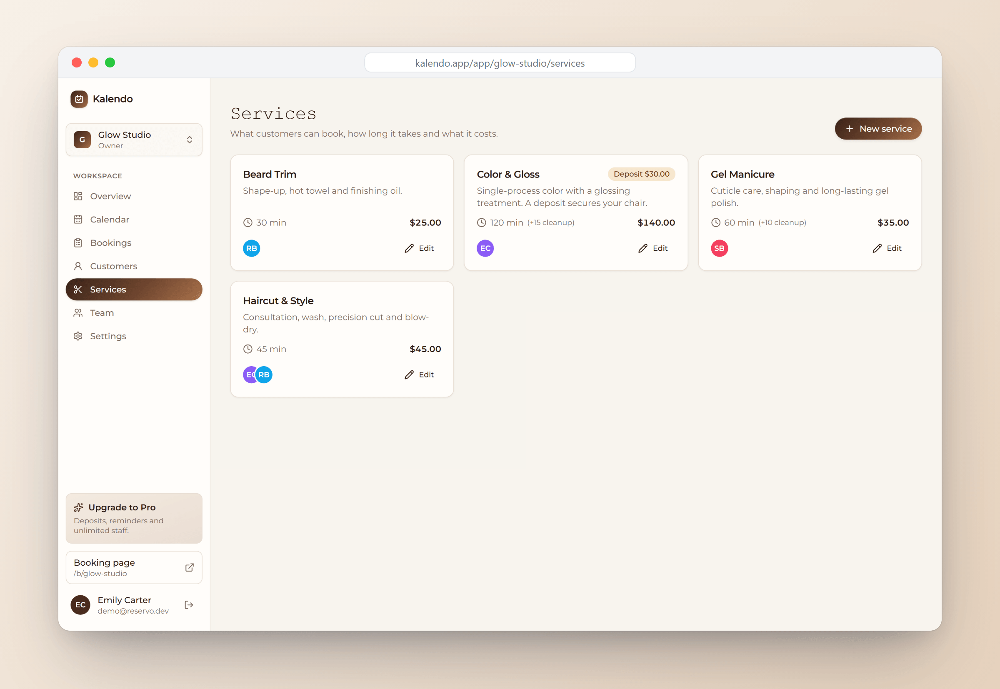
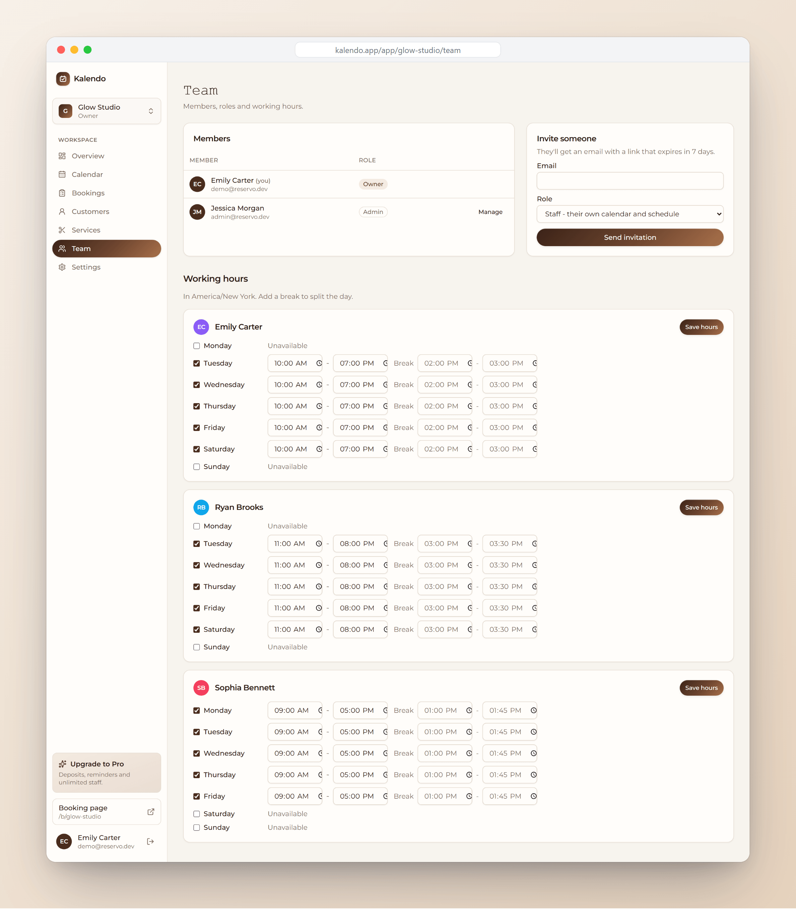
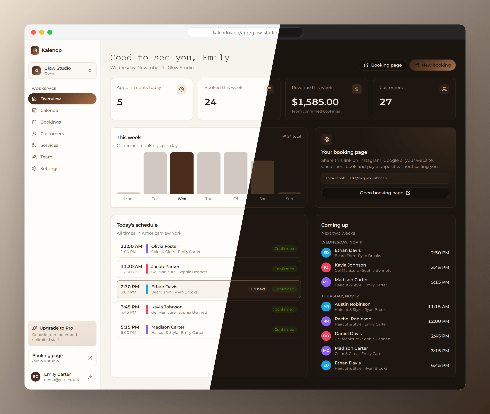
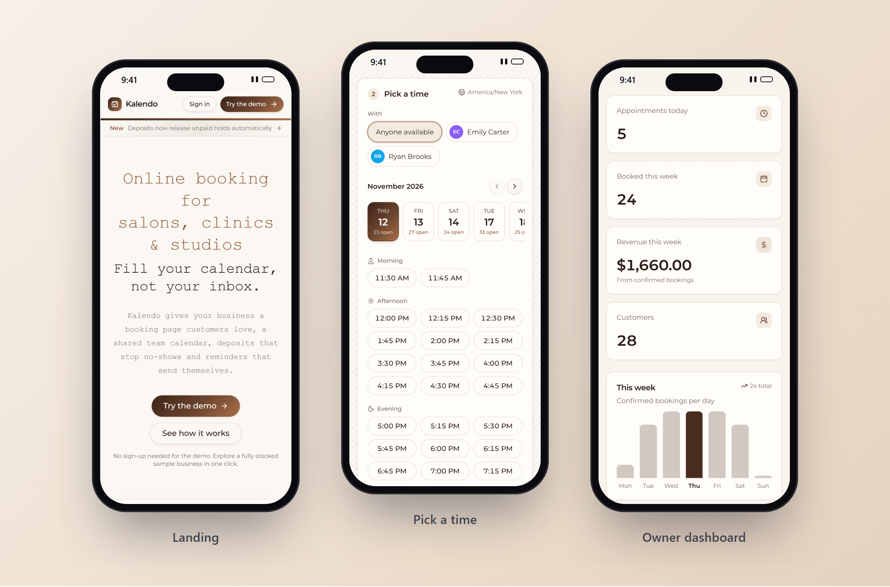
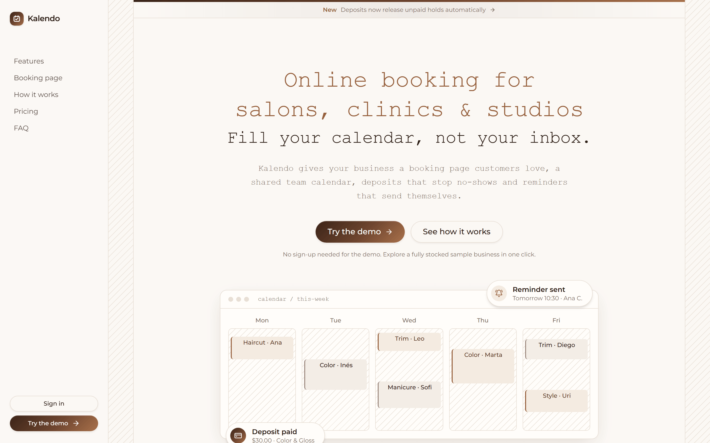
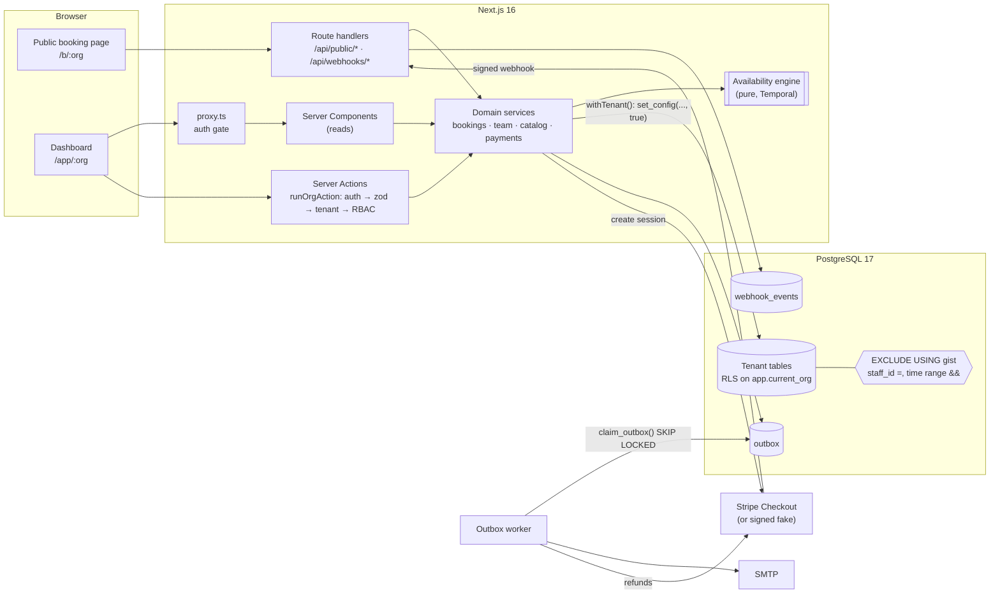

<div align="center">

# Kalendo

**Online booking and team scheduling for salons, clinics and studios, where double bookings and cross-tenant leaks are ruled out by the database.**


[Features](#features) · [Design](#design) · [Screenshots](#screenshots) · [Tech stack](#tech-stack) · [Getting started](#getting-started)

</div>

<br>

<picture>
  <source media="(prefers-color-scheme: dark)" srcset="readme/hero-dark.png">
  
</picture>

## Overview

Kalendo is a multi-tenant booking SaaS. Every business gets a public booking page, a shared team calendar, optional Stripe deposits and automatic confirmation and reminder emails. Owners run everything from one dashboard: bookings, customers, services, staff hours, holidays and billing.

The interesting part is the backend. Tenant isolation is enforced by Postgres Row Level Security, overlapping appointments are rejected by an exclusion constraint, webhooks are idempotent, and every email or refund goes through a transactional outbox. Each of those guarantees has an integration test that runs against real Postgres.

## Try the demo

Run it locally (see [Getting started](#getting-started)) with `DEMO_MODE=1` and click **Try the demo** on the landing page. You are signed straight into **Glow Studio**, a fictional salon with about five weeks of bookings, three staff members and a customer list. No password, no sign-up.

| What | Where |
| --- | --- |
| Dashboard (owner) | `/sign-in` with `demo@kalendo.dev` / `kalendo-demo-2026` |
| Dashboard (admin) | `admin@kalendo.dev` / `kalendo-demo-2026` |
| Public booking page | `/b/glow-studio` (New York) and `/b/northside-physio` (Chicago) |

In demo mode payments use the built-in signed fake checkout and emails are printed to the server log, so nothing needs credentials.

## Features

### A booking page customers finish

A four-step flow (service, staff member or "anyone available", date and time, details) with open-slot counts on every day, times grouped by part of day and shown in the visitor's own time zone. Deposits go through Stripe Checkout; the slot is held while the customer pays and released automatically if they don't.

<picture>
  <source media="(prefers-color-scheme: dark)" srcset="readme/book-dark.png">
  
</picture>

### A calendar the whole team shares

A week view with lanes for overlapping bookings, color-coded staff, a staff filter and a side panel with booking details.

<picture>
  <source media="(prefers-color-scheme: dark)" srcset="readme/calendar-dark.png">
  
</picture>

### Services with real-world rules

Duration, price, deposit and prep/cleanup buffers per service, assigned to the staff who perform it. The availability engine applies the buffers, so back-to-back bookings never overlap.

<picture>
  <source media="(prefers-color-scheme: dark)" srcset="readme/services-dark.png">
  
</picture>

### Team, roles and working hours

Invitations by email, owner/admin/staff roles enforced on the server, and weekly hours with breaks and time off.

<picture>
  <source media="(prefers-color-scheme: dark)" srcset="readme/team-dark.png">
  
</picture>

<details>
<summary><b>Full feature list</b></summary>

**For customers**
- Four-step booking flow: service, staff member (or "anyone available"), date and time, details.
- Date strip with the number of open slots per day; times grouped into morning, afternoon and evening.
- Times shown in the visitor's own time zone, with a one-click switch to the business's zone.
- Deposits through Stripe Checkout. The slot is held while the customer pays and released automatically if they don't.
- If two people grab the same slot, the loser gets a clear message and fresh availability without losing what they typed.
- Confirmation page and email with a self-service cancel link.

**For the business**
- Overview with today's schedule, the next two weeks, weekly bookings chart and revenue.
- Week calendar with lanes for overlapping bookings, a staff filter and a side panel for booking details.
- Bookings list (upcoming, past, cancelled), manual bookings and cancellation with customer notification.
- Customer list with visit history and private notes.
- Services with duration, price, deposit and prep/cleanup buffers, assigned to the staff who perform them.
- Team management: invitations by email, owner/admin/staff roles, weekly hours with breaks, time off.
- Settings: slot interval, minimum notice, booking horizon, holidays, Pro plan billing and an append-only audit log.

</details>

## Design

- **Design tokens.** shadcn/ui-style CSS variables (`--background`, `--card`, `--primary`, `--highlight` and more) feed Tailwind 4 through `@theme`, so every component draws from one palette: a warm cream canvas, latte hairlines, an espresso brand color and a caramel accent.
- **Typography.** Montserrat (through `next/font`) for the interface, with a typewriter-style monospace for page titles and the landing headline, which gives the product a recognisable editorial voice.
- **Dark palette.** A complete dark theme is defined under `.dark` (espresso surfaces, caramel accents). The screenshots show both themes; the app ships light by default and has no theme switch in the UI yet.
- **Responsive.** The dashboard collapses to a top bar with a menu, cards stack into one column, and the public booking flow is built mobile-first.
- **States.** Route-level `loading.tsx` and `error.tsx` in the dashboard, clear empty states, and a race-condition message when someone else takes a slot first that keeps what the customer typed.
- **Accessibility.** Radix primitives for dialogs and menus (focus management and keyboard support), visible focus rings from a `--ring` token, and live regions in the booking widget.

<p align="center"></p>

<picture>
  <source media="(prefers-color-scheme: dark)" srcset="readme/mobile-dark.png">
  
</picture>

## Screenshots

| | |
| --- | --- |
| <br>**Landing page.** One-click demo and a preview of the product. | <picture><source media="(prefers-color-scheme: dark)" srcset="readme/hero-dark.png"></picture><br>**Overview.** Today's schedule, week chart, revenue and the booking-page link. |

All screenshots come from the running app with the seeded Glow Studio demo: desktop at 1440×900 and mobile at 390×844, both at retina resolution. Images switch to dark versions when GitHub is in dark mode.

## Tech stack

| Layer | Technology | Why |
| --- | --- | --- |
| Framework | Next.js 16.4 (App Router, Server Components, Server Actions), React 19.3 | Reads in Server Components, writes in typed Server Actions, no separate API layer for the dashboard |
| Language | TypeScript 6 (`strict`), zod 4 | Types end to end and runtime validation at every boundary |
| UI | Tailwind CSS 4.3, Radix UI primitives, lucide-react, sonner | Accessible primitives on a token-based design system |
| Database | PostgreSQL 17 with Row Level Security and `btree_gist`, Drizzle ORM 0.45, plain SQL migrations | Tenant isolation and no-overlap guarantees live in the database |
| Auth | Better Auth 1.7 (email + password, magic link) | Self-hosted sessions with no vendor lock-in |
| Payments | Stripe 23 (Checkout + webhooks) behind a provider interface, with a signed fake for local use | Deposits work end to end with zero credentials |
| Email | Nodemailer 10 (SMTP, Mailpit in development) | Any SMTP provider, and a real inbox locally through Mailpit |
| Time | Temporal through `temporal-polyfill` | Correct wall-clock and DST handling |
| Tests | Vitest 5 (unit + integration on real Postgres), Playwright 1.64 (E2E) | The guarantees are tested against the real database |
| Tooling | ESLint 9, Prettier 3, tsx, Docker Compose, GitHub Actions | `npm run ci` runs exactly what CI runs |

## Architecture



**Key decisions**

- **Row Level Security instead of `WHERE org_id = ?`.** The app connects as a role that is `NOSUPERUSER NOBYPASSRLS`, and `withTenant()` sets the current organisation with a transaction-local `set_config`. The setting dies with the transaction, which makes it safe with a connection pool, and an unset context fails closed. Cross-table references use composite keys `(org_id, id)` because foreign key checks bypass RLS. The few operations that must cross tenants (slug lookup, claiming outbox rows, expiring holds) are small `SECURITY DEFINER` functions.
- **The database prevents double booking.** An exclusion constraint on `tstzrange(blocked_from, blocked_until)` per staff member rejects overlaps, including prep and cleanup buffers and unpaid holds. Under load, overlapping inserts can deadlock each other, so bookings also take per-staff advisory locks in sorted order and retry on `40P01`. A test fires 25 parallel requests at one slot and expects exactly one winner.
- **Outbox instead of sending email in the request.** The email or refund row is written in the same transaction as the booking, so both commit or neither does. The worker claims batches with `FOR UPDATE SKIP LOCKED`, retries with backoff and jitter, and dead-letters after repeated failures. Delivery is at-least-once; refunds carry a Stripe idempotency key.
- **Idempotent webhooks.** The handler verifies the signature on the raw body, then inserts the event id into `webhook_events` and applies the side effects in one transaction. A redelivery becomes a no-op. A payment that arrives after the hold expired either revives the booking (slot still free) or queues a refund.
- **Two-phase deposit checkout.** The hold commits before the Stripe call, so no transaction or row lock is held across the network.
- **Time zones done properly.** Opening hours are wall-clock times in the business's IANA zone, bookings are `timestamptz`, and the engine takes `now` as an argument. Spring-forward gaps are skipped and fall-back hours are offered twice as distinct instants.
- **Payments behind an interface.** Without Stripe keys a fake provider signs its own events and posts them through the same verify-and-apply pipeline, so deposits work end to end with zero credentials.
- **Demo mode** (`DEMO_MODE=1`) adds one-click sign-in, forces the fake payment provider, logs emails instead of sending them, drains the outbox after each request and enables a nightly reset endpoint for Vercel Cron.

## Engineering highlights

- **Every mutation goes through one pipeline.** `runOrgAction` authenticates, validates input with zod, resolves the tenant, opens an RLS-scoped transaction and checks the role's permission before the handler runs, so a new action can't skip a step.
- **Isolation that fails closed.** `withTenant()` sets the organisation with a transaction-local `set_config`, so the setting can't leak across pooled connections, and a query without it sees nothing.
- **Concurrency handled by Postgres.** The exclusion constraint below makes double booking impossible; a test fires 25 parallel requests at one slot and expects exactly one winner.
- **Reliable side effects.** Emails and refunds are written to an outbox in the same transaction as the booking, claimed with `FOR UPDATE SKIP LOCKED`, retried with backoff and dead-lettered.
- **Strict tooling.** TypeScript `strict`, ESLint, Prettier and a CI workflow that runs typecheck, lint, format, unit tests, integration tests (Postgres service container), build and Playwright.

```ts
// src/server/actions/run.ts
export async function runOrgAction<S extends z.ZodType, R>(
  orgSlug: string,
  permission: Permission,
  schema: S,
  rawInput: unknown,
  handler: (ctx: OrgActionContext<z.infer<S>>) => Promise<R>,
): Promise<ActionResult<R>> {
  try {
    const user = await requireUserOrThrow();
    const input = parseOrThrow(schema, rawInput);
    const orgId = await orgIdBySlug(orgSlug);
    if (!orgId) throw notFound("Organization");
    const ip = clientIp(await headers());

    const data = await withTenant({ orgId, userId: user.id }, async (tx) => {
      const [membership] = await tx
        .select()
        .from(memberships)
        .where(and(eq(memberships.orgId, orgId), eq(memberships.userId, user.id)));
      if (!membership) throw notFound("Organization");
      if (!can(membership.role, permission)) throw forbidden();
      return handler({ tx, actor: { orgId, userId: user.id, role: membership.role }, user, input, ip });
    });
    // ...
```

```sql
-- drizzle/0001_tenant_security.sql
ALTER TABLE public.bookings
  ADD CONSTRAINT bookings_no_overlap
  EXCLUDE USING gist (
    staff_id WITH =,
    tstzrange(blocked_from, blocked_until, '[)') WITH &&
  )
  WHERE (status IN ('pending_payment', 'confirmed'));
```

## Getting started

**Prerequisites**

- Node.js 22.12 or newer (24 recommended)
- Docker (for Postgres, and Mailpit if you want to read emails)

**Setup**

```bash
git clone <your-fork-url> kalendo
cd kalendo
npm install
cp .env.example .env
```

```bash
docker compose up -d
```

This starts Postgres 17 on host port 5433 and Mailpit on 1025 (SMTP) and 8025 (web UI). If 5433 is taken, change the port mapping in `docker-compose.yml` and both URLs in `.env`.

```bash
npm run db:migrate
npm run seed
```

`db:migrate` applies the SQL migrations and creates the restricted app role from `DATABASE_URL`. `seed` creates two demo businesses with bookings from three weeks back to two weeks ahead.

```bash
npm run dev
```

The app runs on http://localhost:3000 together with the outbox worker. Use `npm run dev:web` to run only Next.js. To start over: `npm run db:reset && npm run seed`.


<details>
<summary><b>Environment variables</b></summary>

| Name | Required | Description |
| --- | --- | --- |
| `DATABASE_URL` | Yes | Connection string for the restricted app role. RLS always applies to it. |
| `DATABASE_ADMIN_URL` | Yes | Privileged connection used only for migrations, seeding, reset and test setup. |
| `BETTER_AUTH_SECRET` | Yes | Session signing secret, at least 32 characters (`openssl rand -base64 32`). |
| `BETTER_AUTH_URL` | Yes | Public base URL used by auth callbacks. |
| `NEXT_PUBLIC_APP_URL` | Yes | Public base URL used in links and emails. |
| `MAIL_TRANSPORT` | No | `smtp` (default), `log` (print a summary, send nothing) or `memory` (tests). |
| `SMTP_HOST`, `SMTP_PORT` | No | SMTP server. Defaults point at Mailpit. |
| `EMAIL_FROM` | No | Sender name and address. |
| `STRIPE_SECRET_KEY` | No | Enables real Stripe. Leave empty to use the fake provider. |
| `STRIPE_WEBHOOK_SECRET` | With Stripe | Signing secret from the Stripe dashboard or `stripe listen`. |
| `STRIPE_PRO_PRICE_ID` | With Stripe | Recurring price for the Pro plan upgrade. |
| `FAKE_PAYMENTS_WEBHOOK_SECRET` | No | HMAC secret for the fake provider's webhooks. |
| `DEMO_MODE` | No | `1` turns on the public demo behaviour described above. |
| `CRON_SECRET` | For cron | Bearer token for `/api/cron/outbox` and `/api/demo/reset`. Without it both reject every call. |

</details>

<details>
<summary><b>Stripe (optional)</b></summary>

```bash
stripe listen --forward-to localhost:3000/api/webhooks/stripe
```

Put the printed `whsec_...` in `STRIPE_WEBHOOK_SECRET`, add a test-mode `STRIPE_SECRET_KEY`, and pay with `4242 4242 4242 4242`. Handled events: `checkout.session.completed`, `checkout.session.async_payment_succeeded`, `checkout.session.expired` and `customer.subscription.deleted`.

</details>

<details>
<summary><b>Scripts</b></summary>

| Script | What it does |
| --- | --- |
| `npm run dev` | Next.js dev server and the outbox worker, side by side. |
| `npm run dev:web` | Next.js only. |
| `npm run build` / `npm start` | Production build and server. |
| `npm run worker` | The outbox worker on its own (for production). |
| `npm run db:migrate` | Apply SQL migrations and provision the app role. |
| `npm run db:reset` | Drop everything and migrate again. |
| `npm run seed` | Seed the two demo businesses. |
| `npm run db:generate` | Generate a migration from the Drizzle schema. |
| `npm run typecheck` / `lint` / `format` | TypeScript, ESLint, Prettier. |
| `npm test` | Unit tests. |
| `npm run test:integration` | Integration tests against Postgres. |
| `npm run test:e2e` | Playwright end-to-end tests. |
| `npm run ci` | Everything CI runs, in order. |

</details>

<details>
<summary><b>Project structure</b></summary>

```
drizzle/                 SQL migrations: schema, RLS policies, roles, exclusion constraint
scripts/                 migrate, reset, seed, deploy-db (build-time migrate + demo seed)
src/
  app/
    page.tsx             marketing landing page
    (auth)/              sign-in, sign-up (password + magic link)
    onboarding/ invite/  create a business, accept an invitation
    app/[org]/           dashboard: overview, calendar, bookings, customers, services, team, settings
    b/[org]/             public booking page, booking status and cancel, fake checkout
    api/                 auth, public availability and bookings, webhooks, cron, demo sign-in/reset
  components/            UI primitives, booking widget, dashboard shell, brand
  db/schema.ts           Drizzle schema with composite foreign keys
  lib/availability/      the pure availability engine and its tests
  server/
    db/                  client, withTenant/withUser
    auth/                Better Auth config, sessions, RBAC
    actions/             server actions, all through runOrgAction
    services/            bookings, availability, team, catalog, customers, schedule
    payments/            provider interface, Stripe adapter, signed fake, webhook handling
    outbox/ mail/        outbox topics and backoff, mailer and email templates
    demo/                demo mode, seed data, nightly reset
  worker/                outbox processor and main loop
  proxy.ts               optimistic auth gate (Next 16 middleware)
tests/
  integration/           Vitest against a fresh Postgres database
  e2e/                   Playwright
```

</details>

## Testing & quality

```bash
npm test
npm run test:integration
npm run test:e2e
npm run typecheck
```

- **Unit (171 tests):** the availability engine (split shifts, breaks, overrides, buffers, notice and horizon, DST in New York, Madrid and Lord Howe Island), calendar layout, validation, RBAC matrix, signatures and backoff.
- **Integration:** run as the restricted app role against a separate test database that is created and migrated automatically. They cover RLS with deliberately buggy queries, the exclusion constraint under 25 concurrent requests, duplicate and concurrent webhook deliveries, outbox leases and dead-lettering, team rules and rate limits.
- **E2E:** sign up, create a business, add a service, book publicly, see it in the dashboard, pay a deposit through checkout, and check that another business's owner gets a 404.
- **CI** (`.github/workflows/ci.yml`): typecheck, lint, format and unit tests; integration tests with a Postgres service container; build plus Playwright.

## Deployment

The app targets Vercel with a managed Postgres such as Neon, and `vercel.json` already sets the build command and crons.

- Provide two connection strings to the same database: `DATABASE_URL` for the app role on the pooled host, and `DATABASE_ADMIN_URL` for the owner on the direct host. The first build creates the app role with the password in `DATABASE_URL`, so make it long and random. With the Neon integration you can set `DATABASE_APP_PASSWORD` instead and the URLs are derived for you.
- `npm run vercel-build` applies migrations (and seeds an empty database in demo mode) before `next build`.
- Set `BETTER_AUTH_SECRET`, `BETTER_AUTH_URL`, `NEXT_PUBLIC_APP_URL`, `CRON_SECRET` and either the Stripe variables or `DEMO_MODE=1`.
- Crons: `/api/demo/reset` daily at 06:00 UTC and `/api/cron/outbox` as a daily safety net. On a plan that allows it, run the outbox every few minutes so reminders go out on time, or run `npm run worker` as a long-lived process.
- Outside demo mode, configure Stripe before going live. Without a key the app falls back to the fake provider.

## Roadmap

- Rescheduling by customers and staff, with the same hold and constraint guarantees.
- Cancellation policies: cutoff windows, deposit forfeiture and partial refunds.
- Two-way Google and Microsoft calendar sync as an extra source of busy time.
- SMS and WhatsApp reminders as new outbox topics.
- Fail fast in production when no payment provider is configured.
- Add a theme switch so the existing dark palette can be used.
